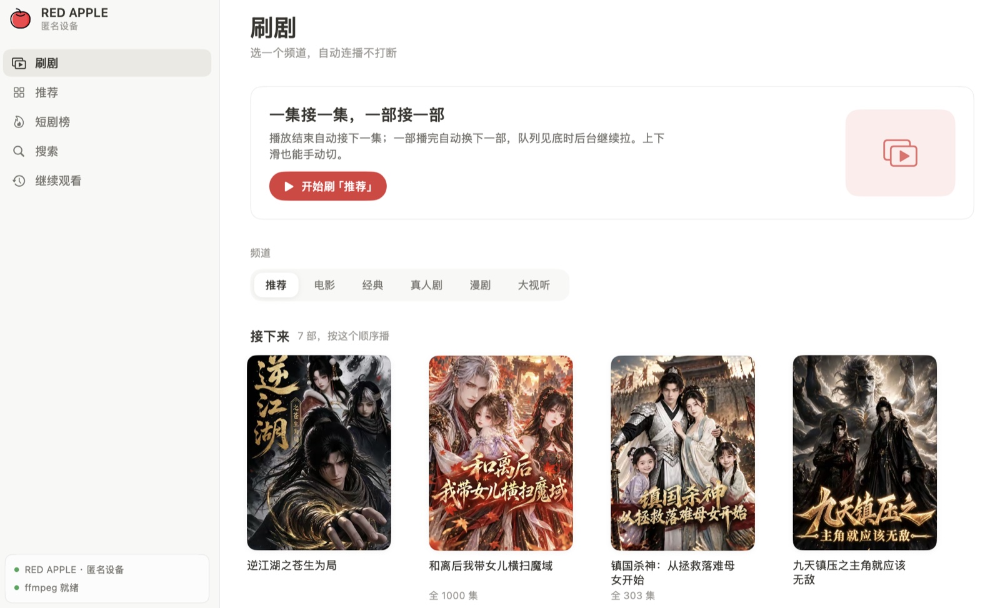

# RED APPLE · hongguo 短剧 macOS 播放器




基于 [`openhongguo`](https://github.com/beilunyang/openhongguo) SDK 的 macOS 桌面短剧播放器。
竖屏刷剧、上下滑切集、自动连播、进度记忆、倍速与清晰度切换。


---

## ⚠️ 免责声明（先读这段）

- **非官方项目。** 与红果短剧、字节跳动、番茄小说及其关联方**无任何关联**，未获其授权或认可。
  相关名称与商标归各自权利人所有，本项目仅作技术指代。
- **仅供个人学习与研究**，议题限于 macOS/SwiftUI 应用架构、DASH/HLS 分片处理、
  播放器工程与界面设计。**禁止任何形式的商业使用**，禁止售卖、二次分发、
  部署为对外服务。
- **不提供、不存储、不传播任何片源。** 所有内容、封面、字幕的版权归原权利人。
  本项目不含任何内容文件，也不含任何硬编码的内容密钥——设备注册、签名、
  密钥获取由上游 SDK 在运行时向服务端请求，本仓库只实现「拿到地址和密钥之后
  如何在本地解密落盘并播放」这一段工程管线。
- **请注意**：即使密钥由第三方取得，使用本程序播放加密内容在多数法域仍可能构成
  规避技术措施，属于法律风险行为，与是否开源无关。请自行确认你所在地区的法律
  与平台条款，**由使用者承担全部责任**；作者不对任何使用后果负责。
- 若权利人认为本项目侵权，请通过仓库 Issue 或邮件联系作者，本项目将立即下架。
- 本项目随时可能停止维护或删除。不要把这里的任何代码当作合规指南。

---

## 快速开始

```sh
# 1. 编译 App 本体
swift build

# 2. 编译访问真 API 的 Go sidecar（需要 Go，不需要 Xcode）
./Scripts/build-sidecar.sh

# 3. 打包成 .app（会把 sidecar 一起塞进 Resources）
./Scripts/make-app.sh
open "build/RED APPLE.app"

# 自测
swift run selftest
```

没有 Go / 没有 sidecar 时 App 会自动退回**离线演示数据**，播放器本身仍可用
（⌘O 打开本地视频）。

## 架构概览

数据层走 `CatalogService` 协议：默认是离线演示数据，接真服务时换成 Go sidecar
（行 JSON 协议，`go build` 即可，不依赖 Xcode）。播放层把不同形态的流统一成一个
`MediaPlan`（地址 + 时长 + 是否需要本地处理）：不需要处理的直接交给 AVPlayer，
需要处理的先落成本地明文文件再播，起播优先走分片流，其次整段落盘。界面是 SwiftUI
两栏布局，播放层覆盖在列表之上，不另开窗口。

## 开源声明

本项目以 **MIT** 许可发布，完整条款见 [LICENSE](LICENSE)。

- **第三方组件**：数据层依赖 [`openhongguo`](https://github.com/beilunyang/openhongguo)
  （Apache-2.0）。其许可证副本见 [LICENSES/Apache-2.0.txt](LICENSES/Apache-2.0.txt)，
  归属与修改说明见 [NOTICE](NOTICE)。
- **ffmpeg 不在本仓库内，也不随打包产物分发**：程序只调用你自己安装的 ffmpeg，
  它的许可证（Homebrew 版本为 GPL-3.0，其他构建可能不同）由使用者自行遵守。
- **不含片源、不含密钥、不含凭据**：仓库里没有任何内容文件、封面素材或设备注册信息；
  运行时产生的状态都在 `~/Library/` 下，已在 `.gitignore` 中排除。
- **图标素材**：`Resources/AppIcon-source.svg` 为第三方图标，版权归原作者；
  衍生的 `AppIcon-1024.png` 与 `AppMark.png` 同源同许可，使用前请自行确认其条款。
- **不接受**以本项目名义进行的商业使用、二次分发或部署为对外服务。
- 欢迎 issue 与 PR；提交即视为同意上述声明同样约束贡献内容。
